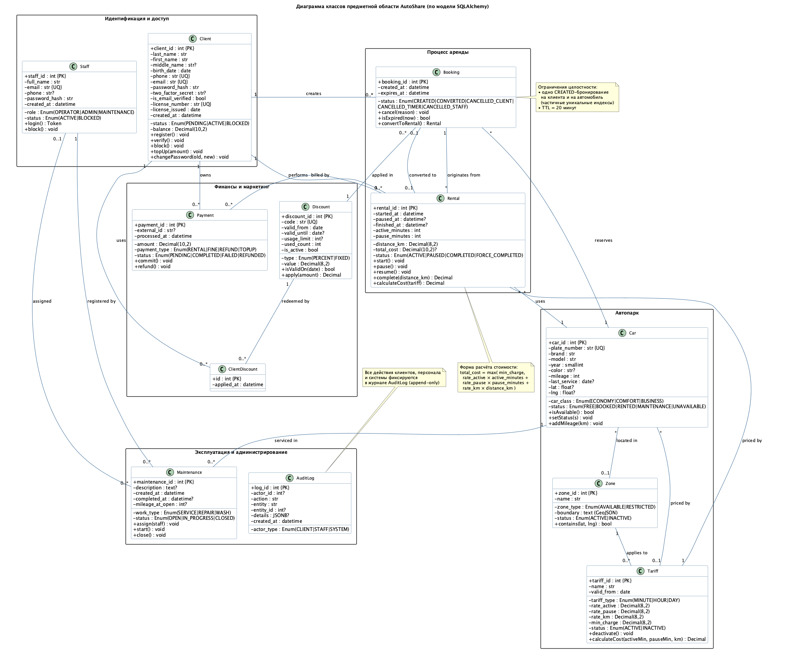
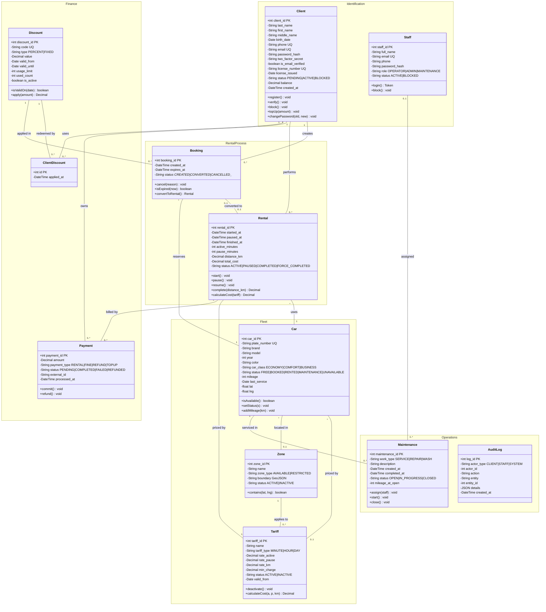

# Диаграмма классов системы AutoShare

**Готовая диаграмма (PNG):** 

Источник диаграммы: [`uml/class-diagram.puml`](uml/class-diagram.puml) (PlantUML) — перерисовка:

```bash
java -jar plantuml.jar -tpng docs/uml/class-diagram.puml
```

Ниже — та же диаграмма в нотации Mermaid (отображается на GitLab/GitHub).



## 1. Описание классов

| Класс | Ответственность | Ключевые операции |
|---|---|---|
| **Client** | Учётная запись клиента, верификация, баланс | `register()`, `verify()`, `block()`, `topUp()`, `changePassword()` |
| **Staff** | Учётная запись сотрудника и его роль | `login()`, `block()` |
| **Car** | Автомобиль автопарка, статус, геопозиция, пробег | `isAvailable()`, `setStatus()`, `addMileage()` |
| **Zone** | Географическая зона обслуживания | `contains(lat, lng)` |
| **Tariff** | Правило ценообразования (мин./час/день + км) | `deactivate()`, `calculateCost()` |
| **Booking** | Бронирование с TTL 20 минут | `cancel()`, `isExpired()`, `convertToRental()` |
| **Rental** | Аренда: тайминги, пробег, стоимость | `start()`, `pause()`, `resume()`, `complete()`, `calculateCost()` |
| **Payment** | Платёж (аренда, штраф, возврат, пополнение) | `commit()`, `refund()` |
| **Discount** | Промокод: процент/фикс, лимиты, сроки | `isValidOn()`, `apply()` |
| **ClientDiscount** | Факт применения промокода клиентом | — (связующая сущность) |
| **Maintenance** | Заявка на ТО/ремонт/мойку | `assign()`, `start()`, `close()` |
| **AuditLog** | Неизменяемый журнал действий | — (append-only) |

## 2. Основные связи

| Связь | Множественность | Семантика |
|---|---|---|
| Client — Booking | 1 : 0..* | Клиент создаёт бронирования |
| Booking — Car | * : 1 | Бронь резервирует автомобиль |
| Booking — Rental | 0..1 : 0..1 | Бронь конвертируется в аренду (обратное — необязательно) |
| Rental — Tariff | * : 1 | Аренда тарифицируется выбранным тарифом |
| Rental — Payment | 1 : 0..* | По аренде может быть несколько платежей |
| Car — Tariff / Zone | * : 0..1 | Автомобиль привязан к тарифу и зоне |
| Zone — Tariff | 1 : 0..* | В зоне действуют свои тарифы |
| Car — Maintenance | 1 : 0..* | История обслуживания автомобиля |
| Staff — Maintenance | 0..1 : 0..* | Исполнитель заявки |
| Discount — ClientDiscount — Client | 1 : 0..* : 1 | Учёт использований промокода |

## 3. Ограничения целостности, отражённые в модели

* `Booking`: частичные уникальные индексы — не более одного `CREATED`-бронирования на клиента и на автомобиль; `expires_at > created_at`.
* `Rental`: `finished_at > started_at`; допустимые статусы фиксированы перечислением.
* `Payment`: `amount <> 0`; тип `RENTAL` требует непустого `rental_id`.
* `Tariff`: `rate_active > 0`, `rate_pause ≥ 0`.
* `Discount`: `value > 0`, `valid_until > valid_from`.
* Все статусы сущностей ограничены `CHECK`-ограничениями на уровне БД.

## 4. Бизнес-правило расчёта стоимости (инвариант класса Rental)

```
total_cost = max( min_charge ,
                  rate_active × active_minutes +
                  rate_pause  × pause_minutes  +
                  rate_km     × distance_km )
```

Реализация: `Rental.calculateCost()` → `POST /api/v1/rentals/{id}/complete`
(`app/api/v1/rentals.py`, строки 123–128).
