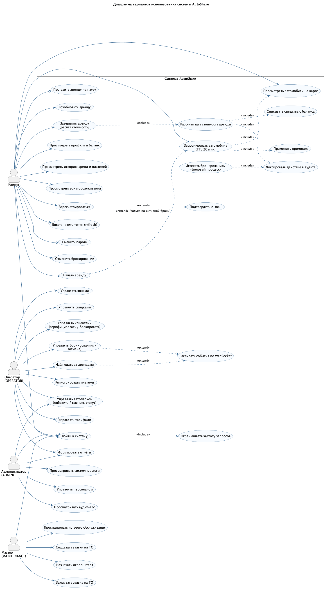
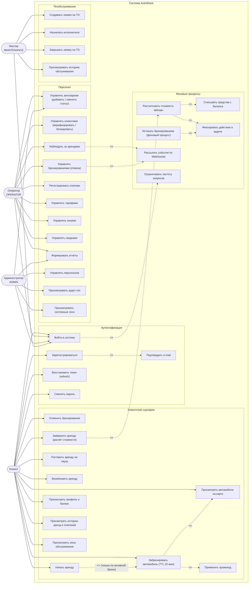

# Диаграмма вариантов использования (Use Case) системы AutoShare

**Готовая диаграмма (PNG):** 

Источник диаграммы: [`uml/use-case-diagram.puml`](uml/use-case-diagram.puml) (PlantUML) — перерисовка:

```bash
java -jar plantuml.jar -tpng docs/uml/use-case-diagram.puml
```

Ниже — та же диаграмма в нотации Mermaid (отображается на GitLab/GitHub).



## 1. Акторы и границы системы

| Актор | Роль | Ограничения доступа |
|---|---|---|
| Клиент | Пользователь каршеринга | Только собственные брони, аренды, платежи; требуется статус `ACTIVE` |
| Оператор | Обслуживание операционных процессов | Автопарк, клиенты, брони, аренды, платежи, тарифы, зоны, скидки, отчёты |
| Администратор | Управление системой | Всё, что у оператора + персонал, аудит-лог, системные логи |
| Мастер | Техническая служба | Заявки на ТО, история обслуживания |
| Система | Фоновые процессы | Истечение бронирований, расчёт стоимости, аудит, WS-уведомления, rate limiting |

## 2. Ключевые варианты использования

### Клиентские сценарии

| UC | Название | Основной поток | Альтернативы/исключения |
|---|---|---|---|
| UC1 | Регистрация | Ввод данных → создание аккаунта `PENDING` → выдача токенов | 409 — e-mail/телефон занят |
| UC2 | Вход | e-mail + пароль → JWT access/refresh | 401 — неверные данные; 403 — аккаунт заблокирован; 429 — превышен лимит 5/мин |
| UC11 | Бронирование | Выбор свободного авто → (опц.) промокод → бронь на 20 мин → авто `BOOKED` | 409 — авто занято; 403 — клиент не `ACTIVE`; ошибка лимита скидки |
| UC13 | Отмена бронирования | Отмена своей брони → авто `FREE` → WS-событие | 403 — чужая бронь |
| UC14 | Начало аренды | Конвертация активной брони → аренда `ACTIVE`, авто `RENTED` | 404 — нет активной брони |
| UC15/UC16 | Пауза/возобновление | Смена статуса и аккумуляция минут | 409 — неверный текущий статус |
| UC17 | Завершение аренда | Расчёт `total_cost` → списание баланса → платёж `RENTAL` → авто `FREE` | 409 — аренда не активна |

### Сценарии персонала

| UC | Название | Актор | Примечание |
|---|---|---|---|
| UC30 | Управление автопарком | Оператор, Администратор | CRUD автомобилей, перевод статусов |
| UC31 | Управление клиентами | Оператор | Верификация (`ACTIVE`) и блокировка |
| UC32 | Управление бронированиями | Оператор | Отмена с причиной `CANCELLED_STAFF` |
| UC34 | Регистрация платежей | Оператор | Типы `RENTAL/FINE/REFUND/TOPUP` |
| UC35/UC36/UC37 | Тарифы, зоны, скидки | Оператор, Администратор | Справочники ценообразования |
| UC38 | Отчёты | Оператор, Администратор | Загрузка парка, финансы, клиенты |
| UC40–UC42 | Персонал, аудит, логи | Администратор | Эксклюзивный доступ роли `ADMIN` |
| UC50–UC53 | Техобслуживание | Мастер | `OPEN → IN_PROGRESS → CLOSED` |

### Системные сценарии

| UC | Название | Триггер | Результат |
|---|---|---|---|
| UC60 | Истечение бронирований | Фоновая задача | `CANCELLED_TIMER`, авто освобождается, запись в аудите |
| UC61 | Расчёт стоимости | Завершение аренды | `total_cost = max(min_charge, rate_active·t_a + rate_pause·t_p + rate_km·d)` |
| UC62 | Списание с баланса | Успешный расчёт | Платёж `RENTAL/COMPLETED`, уменьшение `clients.balance` |
| UC63 | Запись в аудит | Любое значимое действие | `audit_log` с актором `CLIENT/STAFF/SYSTEM` |
| UC64 | WebSocket-уведомления | Изменение брони/аренды | Доставка события всем подписчикам |
| UC65 | Ограничение частоты | HTTP-запрос | `slowapi`: 10/мин регистрация, 5/мин вход |

## 3. Связи `<<include>>` / `<<extend>>`

* `UC11 → UC12` (`include`): применение промокода — часть процесса бронирования, если указан код.
* `UC14 → UC11` (`extend`): аренда возможна только при наличии активного бронирования.
* `UC17 → UC61` (`include`): завершение всегда включает расчёт стоимости.
* `UC61 → UC62`, `UC61 → UC63` (`include`): расчёт включает списание и аудирование.
* `UC1 → UC5` (`extend`): подтверждение e-mail — необязательный шаг, ведущий к статусу `ACTIVE`.
* `UC32/UC33 → UC64` (`extend`): оповещение по WS сопровождает операции с бронью/арендой.
